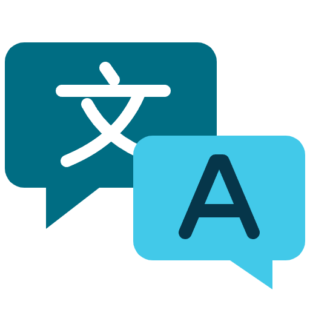

<!-- header:begin (generated from project metadata) -->
<h1 align="center">Custom Integration Translator</h1>

  

---

  
   
  
  
   
  
  
  
  
  

<!-- header:end -->

Translate individual phrases in HACS integrations from within Home Assistant. Compare source and target text, fill missing phrases or retranslate a selection using your existing DeepL account.

[Deutsch](README.de.md)

## Installation

1. Use Home Assistant 2026.11.0 or later. Install and configure [DeepL Translator](https://github.com/seb5594/hass-deepl_translator-integration) first.
2. For manual installation, copy `custom_components/custom_integration_translator` into the matching directory under your Home Assistant configuration folder and restart Home Assistant. For a published release, add this repository to HACS as a custom repository of type **Integration**.
3. With **DeepL Translator 1.0.0b3 or newer** configured, a **Discovered** card appears under **Settings → Devices & services** after HACS/Marketplace installation or startup. Confirm setup and select your DeepL account. Alternatively, use **Add integration → Custom Integration Translator**. Home Assistant's **Ignore** option hides the suggestion persistently. Manual setup still works with older DeepL versions. The discovery card appears in the integrations overview; the associated device is created after setup.
4. As an administrator, press **Open translations** on the integration's device, call `custom_integration_translator.open_workspace`, or visit `/custom-integration-translator` on your instance. Refresh the browser after initial setup if needed. Automations without a user context post a notification linking to the workspace.

## Translate selected phrases

The target defaults to the Home Assistant system language. Available targets are the intersection of HA language keys and languages reported by the selected DeepL account. Under **Configure → Language and sidebar**, you can override the default, save protected words and opt into a sidebar shortcut.

Choose an integration. Missing phrases are preselected. Compare the source and current value, then press **Translate selection**. To inspect a complete translation, turn off **Hide translated integrations**. Incomplete integrations come first. Names are sorted alphabetically within each group.

- English `translations/en.json` is preferred, followed by English `strings.json` and another available developer translation. The workspace displays the source language. Generated files are excluded as translation sources.
- Only selected strings are sent to DeepL. Other target entries, including target-only keys, are preserved. Previously generated phrases are labeled **DeepL**.
- Enter product names with their exact spelling, one per line. The provider masks protected terms and placeholders. An incomplete response or a changed protection marker cancels the write. Your DeepL account's usage terms apply.
- Restart Home Assistant and refresh the browser after writing to update cached translations.

## Discovery and recovery

The translator reacts to completed HACS and Marketplace installations, updates and removals, as well as custom integration loading and system language changes. Events within ten seconds are combined into one check. A startup check and a weekly fallback cover manual file copies. Under **Configure → Language and sidebar**, set the additional check interval to 0–168 hours. The default is 168 hours (one week). Explicitly saved intervals are preserved. Setting 0 disables only the periodic check. A persistent notification links directly to an integration missing the selected language. A Repairs issue links to the missing phrases when a translation already exists. Translation starts only after your selection.

Before modifying an existing file, the translator saves its exact bytes as `translations/<language>.json.bak`. A recovery journal in `.storage/custom_integration_translator/` also holds the original outside the HACS-managed directory. The initial developer version stays available for download even after a restore and a later upstream release. Include that directory in backups.

Use **Restore original** to restore the developer's bytes, or **Delete generated file** if the translator created the file. External edits suspend translation. When an original exists, it is available for download. Explicitly restoring across an external edit preserves the newer file as `<language>.json.<SHA256>.bak`. Automatic cleanup stops on a conflict.

Use **Configure → Disable translator** to choose whether to undo all changes before disabling. Keeping translations is the default. Using Home Assistant's native Disable or Delete command also keeps files and offers a Repairs dialog afterward if there are managed translations. Complete recovery before uninstalling the translator's code through HACS.

## Development

Versions use `YYYY.MM.DD.BUILD`. The adapter in `provider.py` uses the public `deepl_translator.get_languages` and `deepl_translator.translate_text` actions. Another provider can implement language discovery and phrase translation independently of the file recovery and review interface.

<!-- support:begin (generated, shared text) -->
## Say thanks

All my projects are built in my spare time, just for the fun of it. Still, they take a lot of time and care, and many of the smart home gadgets I buy end up here because I want to make them cloud-free and smart-home ready. Every bit of support means a lot to me.

If my work helped you or turned out to be useful, show your appreciation with a hot drink for my next sleepless night.

 
<!-- support:end -->

<!-- license:begin (generated from the license file) -->
## License

Published under the [Apache License 2.0](LICENSE).
<!-- license:end -->
